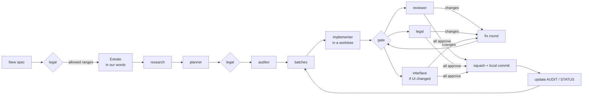

# craft-team

A [Claude Code](https://claude.com/claude-code) skill that turns one session into a small
software team. You talk to the **coordinator**, the main agent. It plans the work, writes
briefs, gates every result, runs CI and commits. Specialised subagents implement, review,
audit, research and plan.

The skill grew out of building a large clean-room desktop application, one feature spec at a
time. It works for any project that has:
- specs to implement;
- a CI command;
- a way to drive the app for real usage tests.

## The team

| Agent | Role | Edits code? | Verdict |
|---|---|---|---|
| `<prefix>-auditor` | Splits a spec into atomic requirements and classifies each against the code and the running app. | No (writes `AUDIT-*.md`) | Counts + prioritized batches |
| `<prefix>-implementer` | Implements one batch in an isolated git worktree: code, regression tests, a usage test in the app, green CI. | Yes, in its worktree | Report |
| `<prefix>-debugger` | Reproduces a bug with a failing test, finds the root cause, fixes it. | Yes, in its worktree | Root cause + fix |
| `<prefix>-reviewer` | Read-only code review covering correctness, never-crash rules, hostile input, tests and conventions. | No | `APPROVE` / `CHANGES` |
| `<prefix>-legal` | Acts as an IP lawyer: clean-room origin, copied wording, trademarks, licences, patents, privacy. Every rejection comes with an alternative that keeps the same behaviour. | No | `APPROVE` / `REJECT` (L1–L3) |
| `<prefix>-interface` | Interface authority held to the Apple/macOS first-party standard. Measures contrast and decides layout and states. | No | `APPROVE` / `REJECT` |
| `<prefix>-research` | Finds public, freely licensed algorithms and standards that reach the same observable result. | No (writes `*-Pesquisa.md`) | Sources report |
| `<prefix>-planner` | Turns the approved material and the research into observable rules, each with a source tag, plus acceptance tests. | No (writes `*-Logica.md`) | Logic file |

The default models are Haiku for the auditor and implementer, Sonnet for the debugger,
reviewer and research, and Opus for legal, interface and the planner. All of them can be
changed per project.

## The flow



**From a spec to batches**
1. The legal agent reviews every new spec before any other agent reads it.
2. The coordinator writes an *Extrato* in its own words from the passages legal allows. From
   then on, agents read only the Extrato.
3. Research and the planner produce the full logic, and legal reviews it again.
4. The auditor turns it into prioritized batches, with bugs and data loss first.

**Each batch**
1. **Brief.** One self-contained file covering:
   - the goal and the base commit;
   - the environment;
   - the sources the agent may read, and the ones it must not;
   - the scope, with exact expected results;
   - the tests and the usage test;
   - the report format.
2. **Implement.** The agent works in an isolated worktree, in the background.
3. **Gate.** All four checks must pass:
   - the CI success line;
   - every build line points into the worktree;
   - the plan-id self-check prints nothing;
   - the working tree is clean.
4. **Review.** The code reviewer and legal always run, together with the interface authority
   when anything visible changed. A rejection from any of them blocks the commit.
5. **Fix rounds.** A fix agent works in the same worktree, then the gate runs again.
6. **Commit.** The coordinator squashes the work into one commit per task id, merges it
   locally by fast-forward, removes the worktree and updates the trackers.

## Rules the skill enforces

- **Never crash.** Non-test code has no panic paths, input is hostile, work and recursion are
  bounded, and every crash fix comes with a regression test that failed before the fix.
- **Fail-before log.** Each new test is one of three things: a recorded failure before the
  fix, new API with no base run, or a guard.
- **Test like a user.** Usage tests use real clicks and keys in the running app, and the agent
  reads its own screenshots. Direct API calls only count as setup.
- **No plan ids in the product.** Code, tests and commits describe behaviour in plain words,
  and `selfcheck.sh` enforces it.
- **Clean-room.**
  - Private specs and test files are never committed and never copied into code.
  - Wording from reference material never reaches the product.
  - No copyleft code.
- **Process safety.** Agents kill only their own PIDs. If an agent's permission is denied,
  the coordinator never performs that action for it; the user is told instead.
- **Builds.** Each live checkout gets its own target directory. If a build is killed for low
  memory, the agent retries once, then clears the incremental cache and retries one more time.
- **Context budget.** Each agent stays under ~500K tokens. Past ~350K, the coordinator starts
  a fresh agent with a handoff brief.

## Installation

1. Put the skill where Claude Code finds it.

   ```sh
   # all projects on this machine
   git clone <this repo> ~/.claude/skills/craft-team
   # or a single project
   git clone <this repo> <project>/.claude/skills/craft-team
   ```

2. Install the team into a project.

   ```sh
   python -I ~/.claude/skills/craft-team/scripts/install.py --project /path/to/repo
   ```

   The first run writes `.claude/team.json` and stops. Fill it in, then run the installer
   again.

   ```json
   {
     "project_name": "MyApp",
     "project_desc": "an open-source, clean-room desktop app",
     "prefix": "myapp",
     "reference_product": "the product you aim to match",
     "rules_file": "CLAUDE.md",
     "spec_dir": "plan/specs",
     "briefs_dir": "plan/briefs",
     "ci_command": "make ci",
     "ci_success_line": "all checks passed",
     "usage_test_hint": "how agents launch and drive the app and take screenshots",
     "ui_theme_hint": "where the UI colour tokens live",
     "ui_languages": "English",
     "reply_language": "English",
     "models": { "implementer": "haiku", "legal": "opus" }
   }
   ```

   The second run writes three things:
   - `.claude/agents/<prefix>-<role>.md` for each of the eight roles. Existing files are kept
     unless you pass `--force`.
   - `.claude/team/`, with the brief, fix-brief, review and legal prompts, the commit message,
     the AUDIT and STATUS templates, and `selfcheck.sh`.
   - `.claude/skills/ui-design-craft`, unless the project already has it.

3. Paste `.claude/team/claude-md-section.md` into your `CLAUDE.md`.
4. Restart the Claude Code session, or open `/agents`, so the new agents load.

## Usage

Ask the coordinator in plain words. For example:
- "Audit `plan/specs/Export.md` and propose batches."
- "Run the Export manual to completion, batch by batch."
- "Write the brief for the next batch."

The skill loads when you mention the team, the batch flow, briefs or reviews, or install the
team. Commits stay local; the coordinator pushes only when you ask it to.

## Layout

```
craft-team/
├── SKILL.md              # coordinator playbook
├── agents/               # role templates with {{placeholders}}
├── templates/            # brief, fix-brief, prompts, commit message, AUDIT, STATUS, self-check
├── scripts/install.py    # renders the agents and templates into a project
└── deps/ui-design-craft/ # UI design skill used by the interface agent and implementers
```

## Requirements

- Claude Code with subagents and git worktree isolation.
- Python 3.8 or later, for the installer.
- A POSIX shell, for `selfcheck.sh`. On Windows, Git Bash works.

## Disclaimer

The legal agent flags risks and proposes engineering alternatives. It does not give legal
advice. For real legal questions, such as specific patents or contracts, consult a lawyer.
